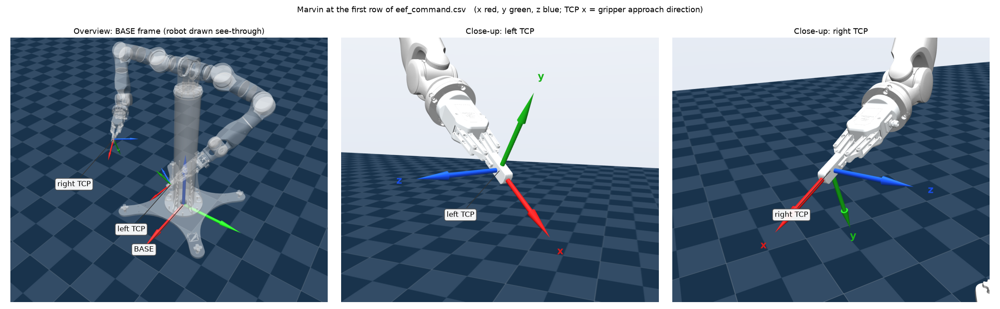

# 测试要求

目的：评估机器人在**在线流式**双臂末端位姿命令下的跟踪能力。与本文不一致的做法，请在报告中逐条说明。

## 1. 输入：`eef_command.csv`

| 列 | 说明 |
|---|---|
| `t_s` | 下发时间轴（s），从 0 开始 |
| `stamp_ns` | 原始时间戳，仅供追溯 |
| `l_x_m, l_y_m, l_z_m` / `r_…` | 左/右臂 TCP 位置（m），BASE 系 |
| `l_qx, l_qy, l_qz, l_qw` / `r_…` | 左/右臂 TCP 姿态，四元数 **xyzw**，BASE 系 |

- 频率约 200 Hz，采样间隔不严格均匀。
- 同一行的左右臂数据属于同一控制周期，必须同步下发。

## 2. 原机器人几何（用于放置轨迹）

- **BASE**：机器人底座坐标系，z 轴竖直向上，x 轴朝前，y 轴朝左。
- **肩部**：左/右臂第 1 关节中心位于 BASE 下 (0, ±0.2115, 1.121) m，轴线水平朝外（左臂沿 +y，右臂沿 −y）。
- **TCP**：位于末端法兰前方 0.227 m 处。TCP 相对法兰的变换如下（平移单位 m，四元数 xyzw）：

  | 臂 | 平移 | 四元数 |
  |---|---|---|
  | 左 | (0, 0, 0.22706) | (−0.5, −0.5, −0.5, 0.5) |
  | 右 | (0, 0, 0.22706) | (0.5, −0.5, 0.5, 0.5) |

  TCP 的 **x 轴即夹爪接近方向**（与法兰 z 轴一致）。

## 3. 执行规则

1. **坐标映射**：两臂共用一个固定的刚体变换 `T_yours_ours`（把 BASE 映射到贵方基坐标系），把轨迹放入贵方的工作空间。不得缩放轨迹，也不得分段调整。如果找不到两臂同时可达的单一变换，请另交一组"左右臂各用一个变换"的结果。
2. **不降速**：严格按 `t_s` 执行。
3. **流式下发**：在运行中逐帧送入命令，可以插值后再下发；不得把整段轨迹载入后做离线规划或前瞻平滑。
4. **不修改轨迹**：不得滤波或剔点；控制器固有的插值、滤波须注明。
5. **起始**：两臂先慢速移到 `meta.json` 中的起始位姿，静止 2 s 后开始执行。
6. **次数与负载**：每个用例连续执行 3 次；空载，或注明负载。
7. **安全**：两臂 TCP 最小间距约 240 mm，请事先确认不会碰撞。

## 4. 回传内容

1. **数据**：每个用例的每次执行各交一个 CSV，采样率不低于 200 Hz，所有列使用同一时钟。列定义如下：

   | 列 | 说明 |
   |---|---|
   | `t_s` | 以第一条轨迹命令下发时刻为 0 |
   | `l_cmd_x, l_cmd_y, l_cmd_z, l_cmd_qx, l_cmd_qy, l_cmd_qz, l_cmd_qw` | 实际送入控制器的左臂 TCP 命令（贵方基坐标系，m，四元数 xyzw） |
   | `l_meas_x … l_meas_qw` | 左臂实测 TCP 位姿，格式同上 |
   | `l_q_cmd_1 … l_q_cmd_N`、`l_q_meas_1 … l_q_meas_N` | 左臂关节命令角与实测角（rad），N 为关节数 |
   | `l_dq_meas_1 … l_dq_meas_N` | 左臂实测关节速度（rad/s） |
   | `l_tau_meas_1 … l_tau_meas_N` | 左臂实测关节力矩（N·m）；若只有电流，请改名为 `l_current_*`（A） |
   | `r_…` | 右臂，与左臂相同 |

2. **说明**（一段文字即可）：所用的 `T_yours_ours`（平移 m，四元数 xyzw）；实测位姿来自编码器正运动学还是外部测量；控制模式与控制周期。
3. **视频**（推荐）：每个用例一段。
